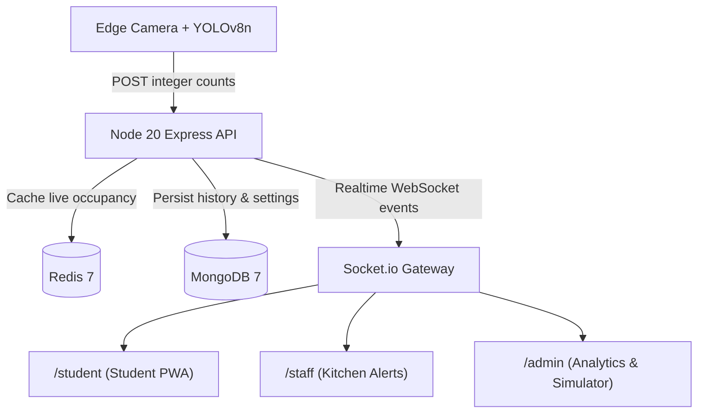

# MessPulse

> **Real-time mess crowd and kitchen-demand platform for hostel students and mess staff — no new hardware.**

[](https://github.com/abhinay905/MessPulse/actions)
[](https://nodejs.org/)
[](LICENSE)
[](docs/demo-runbook.md#minute-400--500--privacy-by-architecture--stale-camera-failover)

MessPulse transforms any existing camera or phone into an entrance counter for university dining halls. It provides students with live crowd levels, wait-time estimates, and optimal arrival windows, while giving kitchen staff predictive tray-depletion alerts without screen clutter.

---

## 🔒 Privacy-by-Architecture Guarantee

MessPulse is built on a strict zero-surveillance design:

- **Zero Frames Stored or Transmitted:** Video streams never leave the local edge device (laptop or Raspberry Pi).
- **Zero Facial Recognition or Biometrics:** The vision detector classifies only anonymous person bounding boxes with YOLOv8n and ByteTrack.
- **Anonymous Integer Ingestion:** The edge script sends only signed net headcounts (`inCount`, `outCount`) to `POST /api/v1/mess/live-count`.
- **Automatic 31-Second Failover:** If the camera disconnects, the system falls back to student session modeling with an "Estimated" badge.

---

## 🏗️ Architecture & Technology Stack



| Layer | Technologies |
|---|---|
| **Frontend** | React 18, TypeScript 5 (Strict), Vite 5, Tailwind CSS 3, Recharts 2 (lazy-loaded), Socket.io Client 4, Vite PWA |
| **Backend** | Node 20 LTS, Express 4, TypeScript 5, Zod 3, Socket.io 4, Pino 9, JWT, Bcrypt |
| **Datastores** | Redis 7 (`ioredis` 5) for real-time states; MongoDB 7 (`mongoose` 8) for audit & history |
| **Vision** | Python 3.11, YOLOv8n, ByteTrack, OpenCV, Pytest |
| **Workspaces** | `npm workspaces` (`apps/api`, `apps/web`, `packages/shared`, `services/vision`) |

---

## 🚀 Quickstart

### Option A: Offline Zero-Dependency Demo (Recommended)

Run the full stack offline with Docker Compose:

```bash
# 1. Start containers (API + MongoDB + Redis)
docker compose -f docker-compose.demo.yml up -d

# 2. Seed database with demo accounts, meals, and 3-day history
npm run seed

# 3. Open your browser:
#    Student View: http://localhost:3000/student
#    Staff View:   http://localhost:3000/staff (PIN: 1234)
#    Admin View:   http://localhost:3000/admin (PIN: 4321)

# 4. (Optional) Run the demo rush simulator from CLI or UI:
npm run simulate -- --speed 6
```

### Option B: Local Development

Prerequisites: Node 20+, MongoDB running on port 27017, Redis running on port 6379.

```bash
# Install dependencies
npm install

# Build shared contracts
npm run prepare

# Run API in dev mode (port 3000)
npm run dev:api

# In another terminal, run Web Vite server (port 5173)
npm run dev -w apps/web
```

---

## 📱 User Journeys

### 1. Student (`/student`)
- **Glanceable Live Status:** Circular occupancy gauge with Low, Medium, High levels.
- **Wait-Time Range:** EMA-smoothed queue delay (e.g. `2–5 min`).
- **Best Windows:** 10-minute green arrival recommendations derived from historical traffic.
- **Check-In Flow:** 1-tap check-in with expected meal stay countdown.

### 2. Kitchen Staff (`/staff`)
- **Calm by Default:** Screen stays dark and silent unless an alert is raised.
- **Predictive Depletion:** Alerts fire 8–10 minutes *before* food runs out based on dining velocity.
- **1-Tap Acknowledgment:** Eliminates duplicate alerts; auto-clears when trays are refilled.

### 3. Administrator (`/admin`)
- **Dual Time-Series Chart:** Visualizes camera headcount alongside decay-weighted student sessions.
- **Decay Curve & Histogram:** Mathematical piecewise decay curve $w(t)$ and live session distribution.
- **Operations Calibration:** Update capacity, service rate, and session durations on the fly.
- **Demo Simulator:** Replay realistic 18-minute lunch rushes at 6x–30x speed.

---

## 🧪 Testing & Verification

```bash
# Run all unit and integration tests across workspaces (280+ tests)
npm test

# Run strict TypeScript typecheck
npm run typecheck

# Run ESLint (zero-warning policy)
npm run lint

# Run Python vision tests
cd services/vision && pytest tests
```

---

## 📖 Documentation

- [Demo Runbook & 5-Minute Script](docs/demo-runbook.md)
- [Architecture & Data Contracts (DOC2)](docs/DOC2.md)
- [Module Design & Specifications (DOC3)](docs/DOC3.md)
- [Implementation Guide & Phasing (DOC4)](docs/DOC4.md)
